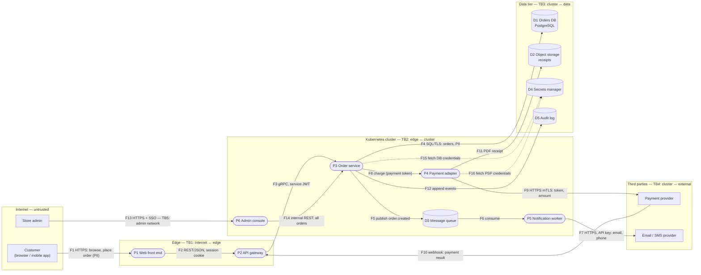
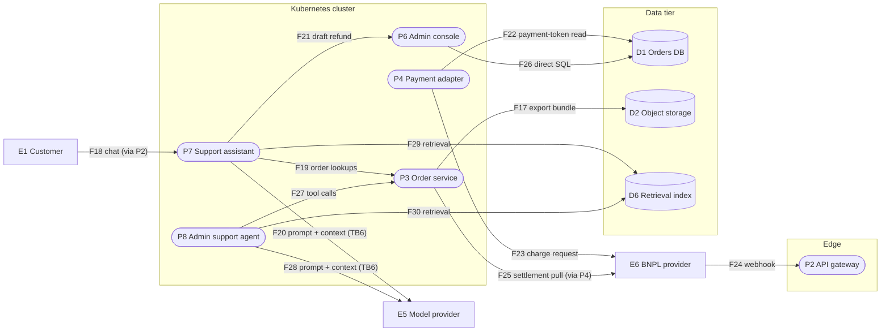

# Ordering platform: data flow diagram

| Field | Value |
|---|---|
| DFD version | 1.0 |
| Source | guide docs/reference/reference-system.md @ 010fd4258fd20434b43da6199246bd02c9eb5e4c |
| Approved by | see ./tmreg dfd status ordering-platform |

## Level-1 diagram

## Extensions

Elements and flows added by the guide's Architect playbooks (E5, E6, P7, P8, D6, F17–F30, TB6).
Flows between existing elements are drawn here too; the level-1 diagram above is unchanged.

## Elements

| ID | Element | Type | Notes |
|---|---|---|---|
| E1 | Customer | External entity | Anonymous until login; browser and native mobile app |
| E2 | Store admin | External entity | Employees; SSO with MFA; reachable only from the admin network |
| E3 | Payment provider | External entity | Tokenizes cards; the platform never stores a PAN |
| E4 | Email / SMS provider | External entity | Receives customer contact data |
| E5 | Model provider | External entity | Hosted LLM API; receives prompts that may contain order data |
| E6 | Buy-now-pay-later provider | External entity | Second payment provider beside E3; its hosted checkout collects credit-decision data from E1 directly; on TB4 under a D4-issued short-lived credential, not mTLS; its webhook F24 enters at TB1 |
| P1 | Web front end | Process | Server-rendered pages plus static assets behind a CDN |
| P2 | API gateway | Process | TLS termination, rate limiting, session validation, webhook ingress |
| P3 | Order service | Process | Core business logic; owns the orders schema |
| P4 | Payment adapter | Process | Wraps the provider API; generates receipts |
| P5 | Notification worker | Process | Consumes queue events; sends email and SMS |
| P6 | Admin console | Process | Internal web app for refunds, order edits, and customer lookup |
| P7 | Support assistant | Process | LLM-backed chat that answers order questions and drafts refund requests |
| P8 | Admin support agent | Process | LLM-backed agent reachable by admins through P6, with tools on P3 |
| D1 | Orders DB | Data store | PostgreSQL; PII, order history, payment tokens |
| D2 | Object storage | Data store | Receipts as PDF; signed URLs |
| D3 | Message queue | Data store | At-least-once delivery; events carry order ID and contact data |
| D4 | Secrets manager | Data store | DB and provider credentials; short-lived tokens |
| D5 | Audit log | Data store | Append-only; who did what to which order |
| D6 | Retrieval index | Data store | Help articles, past support tickets written by customers, support macros, refund-policy documents; read by P7 and P8 |

## Flows

| ID | From | To | Label |
|---|---|---|---|
| F1 | E1 | P1 | HTTPS: browse, place order (PII) |
| F2 | P1 | P2 | REST/JSON, session cookie |
| F3 | P2 | P3 | gRPC, service JWT |
| F4 | P3 | D1 | SQL/TLS: orders, PII |
| F5 | P3 | D3 | Publish order.created |
| F6 | D3 | P5 | Consume |
| F7 | P5 | E4 | HTTPS, API key: email, phone |
| F8 | P3 | P4 | Charge (payment token) |
| F9 | P4 | E3 | HTTPS mTLS: token, amount |
| F10 | E3 | P2 | Webhook: payment result |
| F11 | P4 | D2 | PDF receipt |
| F12 | P3 | D5 | Append events |
| F13 | E2 | P6 | HTTPS + SSO (TB5: admin network) |
| F14 | P6 | P3 | Internal REST: all orders |
| F15 | P3 | D4 | Fetch DB credentials |
| F16 | P4 | D4 | Fetch PSP credentials |
| F17 | P3 | D2 | Order-history export bundle written for later download over F11 |
| F18 | E1 | P7 | Customer chat messages (via P2) |
| F19 | P7 | P3 | Order lookups scoped to the chatting customer |
| F20 | P7 | E5 | Prompt and retrieved order context to the model provider |
| F21 | P7 | P6 | Draft refund submitted for admin approval |
| F22 | P4 | D1 | Payment-token read by P4's own D1 role; F8 then carries the order reference, not the token |
| F23 | P4 | E6 | Charge request: order amount and E6's customer token, under a D4-issued short-lived credential |
| F24 | E6 | P2 | Webhook: payment result, under ADR-10 on ADR-07's signed, idempotent ingress pattern |
| F25 | P3 | E6 | Daily settlement-report pull (via P4); P3 reconciles it against D1 orders |
| F26 | P6 | D1 | Direct SQL under P6's own D1 role with write access, undocumented; found by archaeology, removed under ADR-11 |
| F27 | P8 | P3 | Agent tool calls: get_order, search_customer, issue_refund |
| F28 | P8 | E5 | Prompt and retrieved context to the model provider, across TB6 |
| F29 | P7 | D6 | Retrieval of help articles, support macros, and past customer tickets for the assistant's context |
| F30 | P8 | D6 | Retrieval of support macros and refund-policy documents for the admin agent |

## Trust boundaries

| ID | Boundary | What enforces it |
|---|---|---|
| TB1 | Internet ↔ edge | CDN and WAF, TLS termination at P2 |
| TB2 | Edge ↔ cluster | Network policy; only P2 may call P3; service JWTs |
| TB3 | Cluster ↔ data tier | Private subnets; credentials from D4; TLS to D1 |
| TB4 | Cluster ↔ third parties | Egress allow-list; mTLS to the payment provider; API key to the messaging provider |
| TB5 | Admin network ↔ cluster | SSO with MFA; VPN or zero-trust proxy; separate ingress for P6 |
| TB6 | Cluster ↔ model provider | Egress allow-list; provider data-retention terms; no PII in prompts beyond the current order |

## Data classes

| Class | Examples | Where it lives | Regulatory hooks |
|---|---|---|---|
| PII | name, address, email, phone | D1, D3 (in transit), E4 | GDPR, CCPA |
| Payment tokens | provider token, last four digits | D1, F8–F10 | PCI DSS scope reduction (SAQ A-EP or similar) |
| Order history | items, amounts, timestamps | D1, D2 | Consumer protection, retention policy |
| Credentials and secrets | DB password, provider keys, signing keys | D4 | Internal policy |
| Audit records | actor, action, target, time | D5 | SOC 2 evidence |
